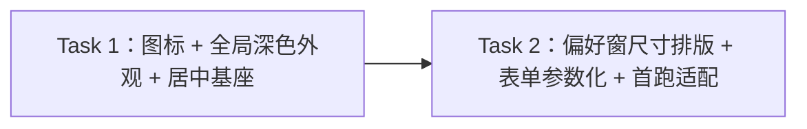

# CC Model UI 视觉优化 实施计划

> 读者：已读 design.md 与 implementation.md；不熟悉本项目实现。实现设计是接口与视觉规格值的唯一权威——本计划只引用其章节号（`I-N`），不复制签名与色值。

## 元数据

- **目标：** 需求方获得视觉升级后的 CC Model——独立设计的菜单栏图标、三窗口现代深邃主题、全部窗口居中、偏好窗口加大松排版——功能行为零变更。
- **架构：** 零新增模块；改动全部落在 UI 层 + 一处纯函数语义变更（I-1）。两条任务链：T1 全局装配层（图标/外观/居中基座），T2 三窗口视觉适配（尺寸/排版/参数化）。
- **技术栈：** AppKit（NSStatusItem/NSWindow/NSAppearance）+ SwiftUI（既有视图改造）+ swift-testing。
- **设计文档（Spec）：** `docs/superpowers/specs/2026-11-06-ui-visual-polish/design.md`（2026-11-06 确认后回填）
- **实施前决策记录 + 日期：** 2026-11-06（decisions.md 五条：图标 D、配色 B、居中、720×480、首跑隐藏默认行）。
- 验证方案见同目录 `verification.md`。
- 实现设计见同目录 implementation.md；本文件是唯一执行依据。

## 1. 改动地图

| 文件 | 任务 | 内容 |
|------|------|------|
| `Sources/ccmodel/ProfileFields.swift` | T1 | I-1 语义变更 |
| `Sources/ccmodel/StatusItemController.swift` | T1 | I-2 图标注入、失败态标题 |
| `Sources/ccmodel/AppDelegate.swift` | T1 | 全局深色外观装配 |
| `Sources/ccmodel/WindowPresenter.swift`（新增） | T1 | I-3 居中基座 |
| `Sources/ccmodel/ImportDialog.swift` | T1 | 弹窗居中、深色继承确认 |
| `Sources/ccmodel/PreferencesWindow.swift` | T2 | 尺寸/最小尺寸/居中/密度 |
| `Sources/ccmodel/ProfileFormView.swift` | T2 | I-4 参数、四档横排、深色微调 |
| `Sources/ccmodel/FirstRunCoordinator.swift` | T2 | 传参 hidesDefaultToggle、两窗居中 |
| `Sources/ccmodel/WelcomeWindow.swift` | T2 | 居中、深色适配 |
| `Tests/ccmodelTests/ProfileFieldsTests.swift`、`ModelSwitcherTests.swift` | T1 | I-1 连带断言更新 |
| `scripts/make-app.sh` | 不触及 | 交付流程不变 |

**实施顺序：** Task 1 → Task 2（Task 2 的窗口基座消费 Task 1 的 WindowPresenter）。

## 2. 功能单元规格

### Task 1: 图标、全局深色外观与窗口居中基座

**职责：** 交付状态项图形图标、全局固定深色外观与窗口居中基座（含弹窗居中）与 I-1 语义变更及连带断言更新；被 Task 2 消费。

**Files:**
- Create: `Sources/ccmodel/WindowPresenter.swift`
- Modify: `Sources/ccmodel/ProfileFields.swift`、`Sources/ccmodel/StatusItemController.swift`、`Sources/ccmodel/AppDelegate.swift`、`Sources/ccmodel/ImportDialog.swift`、`Tests/ccmodelTests/ProfileFieldsTests.swift`、`Tests/ccmodelTests/ModelSwitcherTests.swift`
- Test: 上述 Tests 文件内更新 + 新增（如需）

**Interfaces:**
- Consumes: 基线计划（docs/superpowers/archived/2026-11-04-cc-model/plan.md）Task 1 的 `ProfileFields.statusItemTitle` 与校验纯函数；基线 Task 5 的 `StatusItemController`（titleWriter 缝、deferMenuCloseEvaluation 缝——均保留语义）。
- Produces:
  - `ProfileFields.statusItemTitle(displayName:)` 新语义：返回纯截断名（无 ⇄ 前缀；截断规则不变）——见 implementation.md §I-1。
  - `StatusItemController`：状态项按钮 = `arrow.left.arrow.right` 模板图 + I-1 标题；符号解析回退纯文字标题（经 symbolProvider 注入缝，见 implementation.md §I-2）。
  - `WindowPresenter.prepare(_ window: NSWindow)`：居中于所在屏（首次打开即主屏）——见 implementation.md §I-3。
  - AppDelegate 启动时设置全局深色外观。
  - ImportDialog：`runModal` 前对弹窗窗口居中。
- 调用示例：`WindowPresenter.prepare(preferencesWindow)` 后窗口中心 == 所在屏中心。

**边界条件：**
- 标题语义（逐字断言更新，共两函数四断言）：`statusItemTitle(displayName: "智谱")` == `"智谱"`；超 12 字符名 → 前 12 字符 + 「…」；❌ 返回值含「⇄ 」前缀。
- readEnv 失败/未命中态：文字标题 `"—"`（图标不变）——时序单测期望由 `["⇄ —"]`/`["⇄ —", "⇄ 智谱"]` 改为 `["—"]`/`["—", "智谱"]`。
- 符号不可用回退：`symbolProvider` 注入缝返回 nil → 走纯文字标题路径，不崩溃（单测注入 nil 覆盖回退分支）。
- `titleWriter` 注入缝语义保留：titleWriter 非 nil 时写注入目标，nil 时写真实按钮——图标注入不得破坏该缝（图标设置在 button 上，titleWriter 只管标题字符串）。
- 全局深色外观一次性设置（启动装配处），不逐窗口重复设置。
- 居中：对已可见窗口重复调用 prepare 不产生位置跳变以外的副作用；导入弹窗在 runModal 前居中。
- 环境注意：`swift test` 失败 → 重跑一次 → 仍败 `swift package reset; swift test`。

**验收标准：**
- statusItemTitle 新语义断言改写并通过（两函数共四断言：短名、截断、❌ 前缀对照等）。
- 时序单测期望改写并通过（`["—"]` / `["—", "智谱"]`）。
- 图标回退分支一条断言（symbolProvider 注入 nil → 纯文字标题路径）。
- 既有其余断言（受 I-1 影响 3 个测试函数 6 处断言之外的全部）零改动通过。
- 弹窗居中调用存在（装配代码核查，UI 效果归 verification 人工）。

### Task 2: 偏好窗口尺寸排版与表单参数化、首跑窗适配

**职责：** 交付偏好窗口 720×480 尺寸与松排版、四档横排、`hidesDefaultToggle` 参数化与首跑隐藏默认行、三窗口深色观感落定；全功能回归保持。

**Files:**
- Create: 无
- Modify: `Sources/ccmodel/PreferencesWindow.swift`、`Sources/ccmodel/ProfileFormView.swift`、`Sources/ccmodel/FirstRunCoordinator.swift`、`Sources/ccmodel/WelcomeWindow.swift`、`Sources/ccmodel/AppDelegate.swift`
- Test: `Tests/ccmodelTests/ProfileFormModelTests.swift`（如参数化触及可测件；视图层不写单测）

**Interfaces:**
- Consumes: Task 1 `WindowPresenter.prepare`；基线 Task 6（docs/superpowers/archived/2026-11-04-cc-model/plan.md）的 `ProfileFormModel`（零变更）。
- Produces:
  - `ProfileFormView` 增加 `hidesDefaultToggle: Bool = false`（默认值保既有调用点零改动；`true` 不渲染「设为默认」行——见 implementation.md §I-4）。
  - 偏好窗口：内容尺寸 720×480、最小 660×430、打开前 `WindowPresenter.prepare`。
  - 首跑欢迎窗/表单窗：打开前 `WindowPresenter.prepare`；表单以 `hidesDefaultToggle: true` 构造。
  - AppDelegate.showPreferences 两条路径（首开与复用）均在 makeKeyAndOrderFront 前调用 `WindowPresenter.prepare`（偏好窗居中接线的归属落点）。
  - 视觉规格值全部取 implementation.md §5 色值表。
- 调用示例：`FirstRunCoordinator` 构造表单视图时传 `hidesDefaultToggle: true` → 首跑窗无「设为默认」行，保存后模型仍自动成为默认（行为不变）。

**边界条件：**
- 偏好窗口尺寸：默认内容尺寸恰为 720×480；`contentMinSize` = 660×430；`contentMaxSize` 不设上限。
- 四档横排：四列等宽（HStack spacing 8）；长模型名截断省略（lineLimit 1 + truncationMode middle），不撑破列宽。
- `hidesDefaultToggle` 两个取值的行为分叉仅影响该行渲染；保存链路（含首跑自动默认）零变更。
- 深色微调（输入框底色等）不偏离冻结稿整体观感（design §4 边界）。
- 首跑两窗与偏好窗均经 WindowPresenter 居中。
- 行为零变更红线：保存/切换/导入/通知的一切既有测试零改动通过。
- 环境注意：处置序列照旧。

**验收标准：**
- 既有 139 条测试零改动通过（I-1 连带断言已在 Task 1 更新）。
- `hidesDefaultToggle` 若触及可测件（构造参数存在性、默认 false）以编译与既有视图消费点核查承载；行为正确性由 verification V-06 人工核对。
- 全部视觉约束点（尺寸/最小值/居中调用/参数传递）以装配代码核查承载，UI 效果归 verification 人工核对。

## 3. 设计依据

1. **statusItemTitle 语义变更而非新增并行函数**——图标化后「⇄ 」前缀失去存在意义，保留旧语义会产生「前缀+图标」双重复 presenting；改语义 + 更新断言是最小且自洽路径（implementation §I-1）。
2. **全局 NSApp 外观而非逐窗设置**——三窗口+弹窗统一深色，逐窗设置会有遗漏面（如 alert 的 contentRect 视图）；全局一次性设置语义即「应用固定深色」。代价：未来若要浅色主题需回改一处（YAGNI 下可接受）。
3. **WindowPresenter 独立基座而非三处各写 center()**——居中是横切关注点，基座一处演进（如未来逐屏策略）只改一处；`NSWindow.center()` 本身一行，但调用点纪律（打开前必调）由命名表达。
4. **hidesDefaultToggle 用默认参数**——既有调用点（偏好窗）零改动，首跑一处显式传 true；比拆两个视图组件轻。

## 4. 约束

- 行为零变更红线：139 条既有测试保持全绿（I-1 连带断言按 implementation §I-1 新语义改写是唯一例外，随 Task 1 落地）。
- 零新增依赖；仅 AppKit/SwiftUI/Foundation + swift-testing。
- 状态管理红线沿用：禁 @State 等宏包装器（ObservableObject/@Published/@ObservedObject 或 @Observable）。
- 测试注入临时目录；`swift test` 处置序列照旧（重跑一次 → package reset）。
- 文案逐字红线沿用：通知、菜单、「（默认）」徽标等既有逐字文案零改动；readEnv 失败标题「—」语义不变（前缀已由图标承担）。
- 分支：全部工作在 `feature/ui-visual-polish` 分支。

## 5. 风险清单

| 风险 | 触发条件 | 影响 | 缓解方式 |
|------|---------|------|---------|
| 深色外观下个别系统控件仍呈浅色 | 固定深色外观未覆盖某控件层次 | 观感割裂 | 装配后人工核查三窗口；控件级微调留构建者（design §4） |
| 图标模板图在明/暗菜单栏对比度不足 | 系统渲染差异 | 状态项辨识度下降 | 模板图由系统保证对比度；V-02 人工核对明暗两态 |
| 720×480 在小屏外接显示器放不下 | 屏幕逻辑分辨率极小 | 窗口超出屏幕 | 最小 660×430 + 系统约束窗口入屏；风险量级低 |
| 横排档位长名截断 | 模型 ID 超长 | 信息可读性下降 | lineLimit + middle 截断；可拖宽窗口缓解 |
| 既有 titleWriter 时序测试破坏 | I-1 断言更新遗漏 | 测试红 | Task 1 验收明列改写清单 |

## 执行交接

- **建议执行方式：子代理驱动。** 理由：两个任务边界清晰（装配层/窗口层）、验收标准可独立判真伪，但 Task 1 的图标装配与 I-1 断言更新有一处跨文件连带（titleWriter 时序测试），逐任务全新审查能把语义变更盯住。
- 必需子技能：子代理驱动用 `superpowers:subagent-driven-development`；会话内执行用 `superpowers:executing-plans`。
- 请需求方审查：各任务边界条件与验收标准是否忠实覆盖 design.md 的 V1–V5 与「明确不做」清单。
- 明确确认后才进入实施（确认在呈报环节已完成则直接按选定方式执行）。
- 实施中发现设计必须改：停止实施，回到确认门。

## 附录：独立审读处置记录

待审读。
