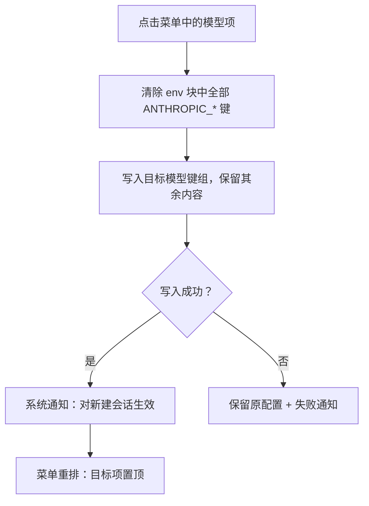
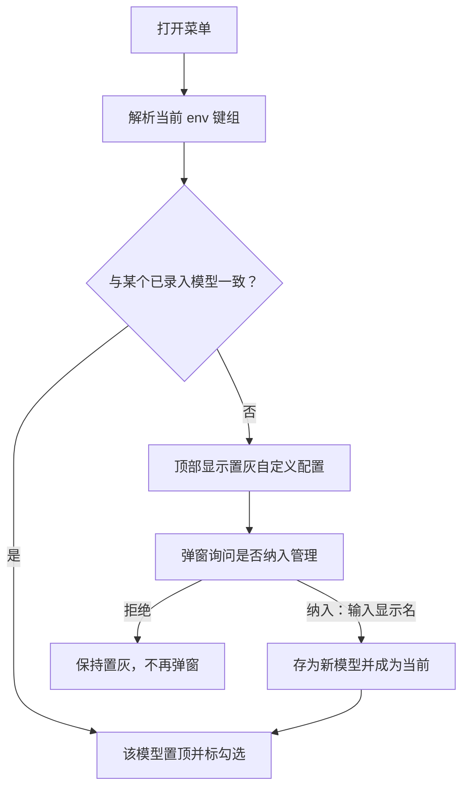
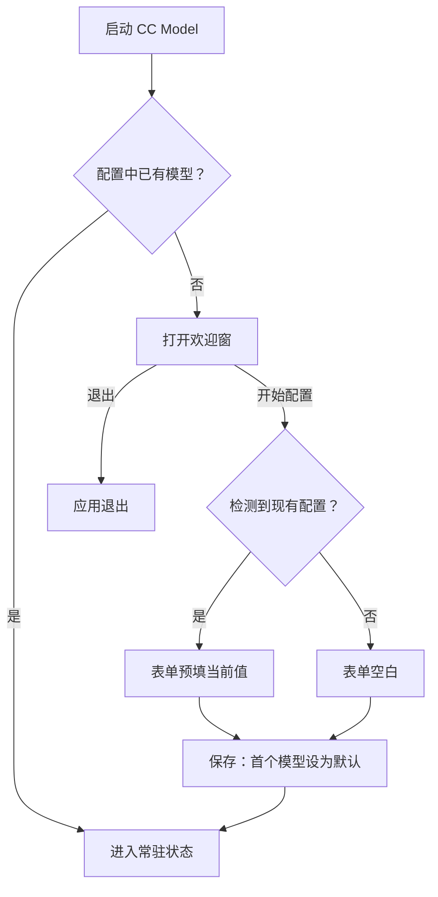

# CC Model 菜单栏应用 · 设计文档

> 读者假设：懂软件工程，不熟悉产生本文档的对话；不需要了解项目内部实现。
>
> 本文档回答：做什么、不做什么、为什么这样取舍、成本量级与主要风险。实现细节留给计划。

**实施前决策记录：** 见 §4 决策速览表；表中「已裁决」指对话中已逐项拍板的设计决策，「设计方决定」指设计方提出、需求方未提出异议的项，均随本文档整体确认生效。**确认日期：** 待需求方对本文档整体确认后回填。

**术语表**

| 术语 | 含义 |
|------|------|
| 状态项 | 常驻 macOS 顶部菜单栏右侧的小图标区域，本应用的入口 |
| 模型 | 一组可整体启用的供应商参数（显示名 + 接入点 + 密钥 + 模型名映射），即一个「供应商档案」 |
| 当前模型 | Claude Code 的全局配置此刻实际生效的模型，与状态项和菜单展示联动 |
| 默认模型 | 用户指定的主力模型，仅作标记，不触发任何自动行为 |
| env 块 | Claude Code 全局配置（`~/.claude/settings.json`）中的 `env` 字段，存放接入点、密钥与各档位模型名等环境变量 |
| 自定义配置 | env 块有值、但不匹配任何已录入模型的情形 |
| 侧栏+详情 | 偏好窗口布局：左侧模型列表、右侧选中模型表单，与 macOS 系统设置一致 |

## 1. 背景与目标

- 解决什么问题：Claude Code 通过全局配置中的 env 块决定使用哪家供应商。用户在一家供应商限额用完时，需要手动编辑或整文件替换该配置切换到另一家——手工操作繁琐且有覆盖掉插件等其他设置的风险。
- 给谁用：单一用户——需求方本人的这台 Mac，个人工具，不分发。
- 成功判断标准：需求方在菜单栏点一下模型名，Claude Code 的下一个新会话即使用该供应商，且全局配置中与模型无关的内容原样保留。

## 2. 功能清单

### F1 菜单栏状态项与菜单

1. **定位：** 应用唯一的常驻入口——状态项显示当前模型，菜单承载切换与管理入口。
2. **触发与输入：** 应用启动后自动出现状态项；点击状态项打开菜单。输入为已录入模型列表与当前模型识别结果。
3. **执行要点：**
   - 状态项显示「交换图标 + 当前模型显示名」。
   - 菜单第一项为当前模型，带勾选标记。
   - 其余模型按「最近选择在前」排列。
   - 默认模型显示名后附「（默认）」标注，无论它是否为当前模型。
   - 点击任一模型项即触发切换（见 §2 F2）；下一次打开菜单时，该模型项位于菜单顶部。
   - 每次打开菜单时重新识别当前模型（见 §2 F3）。
   - 无任何选择记录时，菜单按添加顺序排列，默认标注照常显示。
   - 状态项中显示名过长时截断显示，完整名在菜单中展示；具体截断长度由构建者定（见 §4 留给构建者的部分）。
   - 菜单底部依次为「偏好设置…」「退出 CC Model」。
4. **出口表：** 单一出口——点击菜单项后按项类型分别进入切换（F2）、偏好窗口（F4）或退出应用。
5. **流程图：** 不配图——菜单渲染为确定性行为，无分支。
6. **本次不做：** 见 §3 第 1、7 条。

### F2 模型切换

1. **定位：** 核心功能——一键把 Claude Code 的 env 块替换为目标模型的参数。
2. **触发与输入：** 点击菜单中的模型项。输入为该模型保存的全部键值组（规范字段映射见 §2 F5）。
3. **执行要点：**
   - 切换时清除 env 块中全部 `ANTHROPIC_*` 前缀键，再写入目标模型的键值组。
   - env 块中非 `ANTHROPIC_*` 的键（如更新器开关）原样保留。
   - 配置文件中 env 块之外的全部内容（插件、市场登记等）原样保留。
   - 目标模型留空的档位映射字段，切换后 env 块中不存在对应键。
   - 切换成功后发出系统通知：「已切换到〈显示名〉，对新建会话生效」。
   - 切换失败时保留原配置不变，并发出失败通知。
   - 首次发出通知前向系统请求通知授权；授权被拒时切换仍执行，仅无通知回执。
4. **出口表：**

   | 出口 | 条件 | 去向 |
   |------|------|------|
   | 切换成功 | 配置写入完成 | 通知 + 菜单重排，目标项置顶 |
   | 切换失败 | 读写配置出错 | 原配置保留 + 失败通知 |

5. **流程图：**

6. **本次不做：** 见 §3 第 1、4 条。

### F3 当前模型识别与自定义配置

1. **定位：** 让菜单如实反映外部现实——配置被手动改过时也能自洽。
2. **触发与输入：** 每次打开菜单时自动执行。输入为 env 块当前的键值组。
3. **执行要点：**
   - 一致的判定：env 块中全部 `ANTHROPIC_*` 键与某模型的键集合完全相等，且逐键值相等；满足则该模型为当前模型。
   - env 块为空或与任何模型都不一致时，菜单顶部显示置灰的「自定义配置」项。
   - 出现自定义配置、且该 env 状态此前未被询问过时，在菜单关闭后弹窗询问是否将其纳入管理。
   - 纳入时用户输入显示名（重名校验与 §2 F5 表单规则相同，重名时提示改名），当前全部 `ANTHROPIC_*` 键值（含表单之外的显示键等变体键）存为一个新模型，并成为当前模型。
   - 用户拒绝纳入时保持置灰显示，不再重复弹窗，直到 env 再次变化。
4. **出口表：**

   | 出口 | 条件 | 去向 |
   |------|------|------|
   | 匹配成功 | env 与某模型键值组一致 | 该模型置顶标勾选 |
   | 自定义配置 | env 为空或无匹配 | 置灰显示 + 询问纳入（一次） |

5. **流程图：**

6. **本次不做：** 见 §3 第 6 条。

### F4 模型管理与偏好窗口

1. **定位：** 模型的增删改入口与全局偏好的存放处。
2. **触发与输入：** 点击菜单「偏好设置…」。输入为模型列表与两项全局偏好。
3. **执行要点：**
   - 窗口为侧栏+详情布局：左侧模型列表（按添加顺序稳定排列），右侧选中模型的表单（见 §2 F5）。
   - 侧栏底部提供「＋添加」「－删除」按钮和「开机自启」开关（见 §2 F7）。
   - 只剩一个模型时，「－删除」按钮置灰不可用。
   - 删除的模型恰为默认模型时，列表第一个模型自动补为默认。
   - 「设为默认」通过表单中的勾选框完成；全应用同一时刻只有一个默认模型。
   - 侧栏列表顺序不受菜单重排影响。
   - 默认模型在侧栏行内显示「默认」徽标。
4. **出口表：**

   | 出口 | 条件 | 去向 |
   |------|------|------|
   | 新增 | 点击 ＋ 并保存表单 | 新模型入列尾，不自动成为当前 |
   | 删除 | 点击 －（≥2 个模型时） | 模型移除；若为默认则首个补位 |
   | 修改 | 表单改动并保存 | 参数更新，不自动切换 |

5. **流程图：** 删除路径含分支，判据简单，用出口表表达即可，不配图。
6. **本次不做：** 见 §3 第 2、3 条。

### F5 模型参数表单

1. **定位：** 单个模型的参数编辑界面，偏好窗口与首跑配置共用同一表单。
2. **触发与输入：** 侧栏选中模型、点击 ＋、首跑「开始配置」，三个入口共用本表单。输入为模型参数八个规范字段。
3. **执行要点：**
   - 规范字段八项：显示名、接入点 URL、API Token、主模型名、Fable/Opus/Sonnet/Haiku 四档映射。
   - 字段与 env 键的对应（已按 2026-11-04 Claude Code 官方文档核实）：接入点→`ANTHROPIC_BASE_URL`；Token→`ANTHROPIC_AUTH_TOKEN`；主模型→`ANTHROPIC_MODEL`（值可含 1M 上下文后缀 `[1m]`）；四档映射→`ANTHROPIC_DEFAULT_FABLE_MODEL` / `ANTHROPIC_DEFAULT_OPUS_MODEL` / `ANTHROPIC_DEFAULT_SONNET_MODEL` / `ANTHROPIC_DEFAULT_HAIKU_MODEL`（此四键为档位别名的模型解析键）。
   - 〔待需求方裁决〕带 `_NAME` 后缀的键（如 `ANTHROPIC_DEFAULT_SONNET_MODEL_NAME`）为 `/model` 选择器显示名，可选、不参与模型解析。建议规则：档位字段被编辑时，若该模型已捕获同名 `_NAME` 显示键，则同步更新为去掉 `[1m]` 后缀的新值，保证选择器显示与实际值一致。
   - 保存条件：显示名非空且不与已有模型重名；接入点、Token、主模型均非空；四档映射可留空。
   - Token 以密码态显示（圆点遮蔽），可切换为明文查看。
   - 表单之外的额外键值不展示，但随模型一起保存与切换（见 §2 F3）。
4. **出口表：** 单一出口——保存时校验通过则参数生效；校验不通过则逐字段提示，不保存。
5. **流程图：** 不配图——校验为确定性规则。
6. **本次不做：** 见 §3 第 6 条。

### F6 首次运行引导

1. **定位：** 全新安装第一次启动时的说明与强制配置流程。
2. **触发与输入：** 应用启动且配置中没有任何模型时自动进入。输入为当前 env 块（可能为空）。
3. **执行要点：**
   - 先显示欢迎窗：说明应用用途、切换原理（改写 env 块），以及是否检测到可预填的现有配置。
   - 欢迎窗提供「开始配置」（主按钮）与「退出」（次按钮）。
   - 检测到 env 块含 `ANTHROPIC_*` 键时，按 §2 F3 的同一捕获规则预填全部键值（含表单之外的显示键等变体键），显示名留空待用户命名。
   - 配置表单校验通过并保存前，无法进入常驻状态；首个模型自动设为默认。
   - env 块为空时欢迎窗提示需手动填写，其余流程相同。
4. **出口表：**

   | 出口 | 条件 | 去向 |
   |------|------|------|
   | 完成配置 | 欢迎窗→表单→保存成功 | 进入常驻状态 |
   | 放弃 | 欢迎窗点「退出」 | 应用退出，不留任何写入 |

5. **流程图：**

6. **本次不做：** 见 §3 第 1 条。

### F7 开机自启

1. **定位：** 可选的登录自启动，保证菜单栏常驻。
2. **触发与输入：** 偏好窗口侧栏底部的开关。输入为开关状态。
3. **执行要点：**
   - 开启即登记系统登录项，关闭即注销。
   - 开关状态在应用重启后保持，初始默认为关闭。
   - 登记结果反馈给用户（成功静默、失败提示）。
4. **出口表：** 单一出口——开关状态持久保存，即时生效。
5. **流程图：** 不配图——单一开关行为。
6. **本次不做：** 见 §3 第 5 条。

## 3. 明确不做

1. 不做任何自动切换（含启动时恢复默认模型）——因为需求方明确要求 app 不得擅自改动运行环境，「默认」只是标记。
2. 不做供应商额度/用量监控——因为切换时机由用户自行判断，监控需对接各家供应商接口，超出个人工具范围。
3. 不管理项目级/目录级配置——因为使用场景是单机全局切换，项目级配置应由 Claude Code 自身机制处理。
4. 不做已运行会话的热生效——因为环境变量由 Claude Code 会话启动时读取，属宿主行为，app 只能以通知告知「对新建会话生效」。
5. 不做分发签名、公证与上架——因为个人工具，临时签名本机可用；分发是新的需求，需重新走设计。
6. 不管理 `ANTHROPIC_*` 之外的自定义环境变量——因为需求方确认无此类需求；非 ANTHROPIC 键永远原样保留。
7. 不做 Windows/Linux 支持——因为需求明确是 macOS 菜单栏应用。

## 4. 关键决策记录

| 决策 | 一句话结论 | 拍板状态 | 影响功能项 |
|------|-----------|---------|-----------|
| 技术栈 | 原生 Swift：AppKit 菜单 + SwiftUI 窗口，命令行工具链构建 | 已裁决（2026-11-04，需求方在「原生 Swift / Tauri 2 / Electron」三案中选定原生 Swift） | 全部 |
| 菜单栏形态 | 图标 + 当前模型名 | 已裁决（2026-11-04，需求方在「仅图标 / 图标+模型名 / 仅模型名」三案中选定图标+模型名） | F1 |
| 偏好窗口布局 | 侧栏 + 详情 | 已裁决（2026-11-04，需求方在「侧栏+详情 / 单窗分区 / 表格+详情」三案中选定侧栏+详情） | F4、F5 |
| 首跑流程 | 欢迎窗 + 强制表单，两步走 | 已裁决（2026-11-04，需求方提出改良并确认） | F6 |
| env 替换语义 | 全量清除 `ANTHROPIC_*` 再写入目标键组 | 设计方决定，随设计确认生效 | F2、F3、F5 |
| 数据存储 | 应用自有配置文件（权限 0600），不进钥匙串 | 设计方决定，随设计确认生效 | F4、F5 |
| 排序语义 | 菜单按最近选择，侧栏按添加顺序 | 设计方决定，随设计确认生效 | F1、F4 |
| 默认模型语义 | 纯标记，无自动行为 | 已裁决（2026-11-04，需求方明确） | F1、F4 |
| 切换通知 | 成功/失败均发系统通知 | 设计方决定，随设计确认生效 | F2 |

除速览表外，审读补全的次级行为项（初始排序、开关默认值、状态项截断、侧栏徽标、弹窗时序、通知授权降级、重名校验适用范围）由设计方敲定，已写入 §2 各功能卡片执行要点。

**D1 技术栈**
1. 候选：原生 Swift（AppKit+SwiftUI）；Tauri 2；Electron。
2. 选择：原生 Swift。
3. 依据：产品全部界面就是一个原生菜单加一个表单窗口，原生栈最贴合；产物几 MB、零运行时依赖；需求方机器已有命令行工具链，Tauri 需新增 Rust 工具链且托盘菜单细节不如原生顺手，Electron 常驻内存过重。
4. 代价：需求方机器无完整 Xcode，日后要做复杂 UI 需补装；实测（2026-11-04）CLT 下 SwiftUI 的宏类属性包装器（`@State`/`@Observable`）不可用，状态管理须走 `ObservableObject`+`@Published` 路径（已实测可编译），界面表达能力受此约束。成本量级：小，单人单应用，估计 2–4 个工作日（含切换、偏好、首跑、打包与联调）。

**D2 菜单栏形态**
1. 候选：仅图标；图标+当前模型名；仅模型名文字。
2. 选择：图标 + 当前模型名。
3. 依据：切换场景由「限额用完」驱动，不点菜单就能看到当前供应商最有价值；模型显示名都很短，菜单栏占用小。
4. 代价：状态项比纯图标宽，菜单栏空间紧张的用户需自行取舍；已通过两轮浏览器视觉稿对比由需求方确认。成本量级：可忽略。

**D3 偏好窗口布局**
1. 候选：侧栏+详情；单窗分区表单；表格+详情。
2. 选择：侧栏 + 详情。
3. 依据：与 macOS 系统设置一致，列表、增删、表单各归其位；模型增多不挤。
4. 代价：窗口宽度略大；实现复杂度略高于单窗表单；已通过视觉稿对比由需求方确认。成本量级：小。

**D4 首跑流程**
1. 候选：直接弹强制表单；欢迎窗+表单两步。
2. 选择：欢迎窗 + 表单两步。
3. 依据：直接甩表单生硬、无上下文；先解释用途与原理再动手，且给「退出」反悔出口。「必须配置至少一个模型」的约束保留——没有模型应用无事可做。
4. 代价：首跑多一步点击；欢迎窗文案需维护。成本量级：可忽略。

**D5 env 替换语义**
1. 候选：仅覆盖表单八字段对应键；全量清除 `ANTHROPIC_*` 再写入。
2. 选择：全量清除再写入。
3. 依据：现有配置含 `_NAME` 变体键，只覆盖会在切换后残留上一家的旧键，可能互相干扰；全量替换保证 env 中模型相关状态与目标模型严格一致。
4. 代价：用户在 env 块手工放置的其他 `ANTHROPIC_*` 变量会被清除（需求方确认无此场景）；模型捕获的显示键等额外键随模型写入，其与表单编辑的一致性由同步规则保证（见 §2 F5，待需求方裁决）；依赖「供应商参数都走 `ANTHROPIC_*` 前缀」这一事实。成本量级：可忽略（替换逻辑一次实现）。

**D6 数据存储**
1. 候选：应用自有配置文件（0600）；macOS 钥匙串存密钥。
2. 选择：应用自有配置文件。
3. 依据：单机个人工具，文件透明可检查、易备份易迁移；钥匙串读写会显著增加实现复杂度，收益仅在不跑共享环境的一台机器上有限。
4. 代价：Token 以明文落盘（权限 0600 缓解）——且密钥本就以明文存放在 Claude Code 全局配置中，改用钥匙串并不改变明文现状；若机器多人共用需回头加密（新需求）。成本量级：小（钥匙串方案会显著增加实现复杂度，此处避免）。

**D7 排序语义**
1. 候选：菜单与侧栏都按最近选择；菜单重排、侧栏稳定。
2. 选择：菜单按最近选择重排，侧栏按添加顺序稳定排列。
3. 依据：菜单重排是需求方指定行为，符合「常用靠前」直觉；管理列表跳动会让删除、对照时找不着位置。
4. 代价：两处顺序不一致，需在实现中区分两个排序来源。成本量级：可忽略。

**D8 默认模型语义**
1. 候选：默认模型带自动行为（启动恢复）；纯标记。
2. 选择：纯标记。
3. 依据：需求方明确「你不要帮我自动切」；标记已满足「记住主力模型」的诉求。
4. 代价：无功能性代价；仅文案上需让「（默认）」不被误解为自动恢复。成本量级：无。

**D9 切换通知**
1. 候选：无通知；成功与失败均通知。
2. 选择：均通知。
3. 依据：切换不改变已开会话，用户需要一条明确回执说明「何时生效」；失败时静默会让人以为切换成功。
4. 代价：每次切换一条通知，频率低，不构成打扰；通知授权被拒时回执不可达（降级为无通知，切换本身不受影响，见 §2 F2）。成本量级：可忽略。

#### 留给构建者的部分

- 状态项图标的具体字形与尺寸适配（视觉稿中为示意符号），依据：示意已传达「图标+文字」形态，字形选型属实现细节。
- 「自定义配置」纳入弹窗中显示名的预填规则（如取接入点域名主体），依据：仅首次输入体验，不影响行为定义。
- 配置文件的内部字段组织（JSON 结构细节），依据：存储已定，内部组织由实现自便。
- Token 明/密文显隐的交互细节（点击切换或独立按钮），依据：密码态显示已定，切换方式属实现细节。
- 状态项显示名截断的具体字符数，依据：截断行为已定（§2 F1），精确数值属实现细节。
- 通知文案与窗口尺寸间距的微调（不改变已定布局、字段与行为定义），依据：已定内容与布局，像素级调整不改变行为。
- SwiftUI 窗口状态管理的具体组织（须避开宏类包装器，见 §5），依据：编译工具链实测约束，具体组织由实现自便。

## 5. 关键约束与可行性风险

- 成本上限：单人开发，量级估计 2–4 个工作日（含切换、偏好、首跑、打包与联调验证）。
- 构建环境仅有 Command Line Tools（已实测，2026-11-04）：AppKit 状态项/菜单、SwiftUI 表单（`ObservableObject`+`@Published` 路径）、系统通知与登录项 API 均可编译；宏类属性包装器（`@State`/`@Observable`）因宏插件缺失不可用；日后复杂 UI 需补装完整 Xcode。
- 交付物为 .app 应用包，由构建脚本产出，放入 /Applications；开机自启采用系统登录项服务（macOS 13+），应用位于 /Applications 时注册最稳定，在构建目录直接运行时注册可能失效。
- Claude Code 会话仅在启动时读取 env 块：切换对已运行会话无效，产品上以通知文案明示，不做规避。
- 全局配置文件同时被 Claude Code 自身写入：存在读取—修改—写回的竞态窗口，后果是覆盖对方一次更新；双方写入均为人工操作级低频，此风险量级低，可接受。
- 临时签名（ad-hoc）仅本机有效：不可分发，与 §3 第 5 条一致。
- 上游机制变更风险：Claude Code 未来若改变模型选择机制（不再经 env 块），本应用核心功能失效，需重新设计。可观察信号：切换后新会话未使用新模型；跟进渠道：Claude Code 版本发布说明（本次键位事实已对照 2026-11-04 官方文档核实）。

## 附录：独立审读处置记录

待审读。
