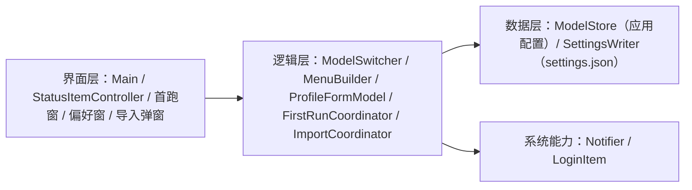
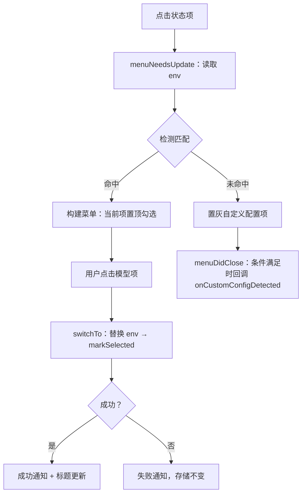
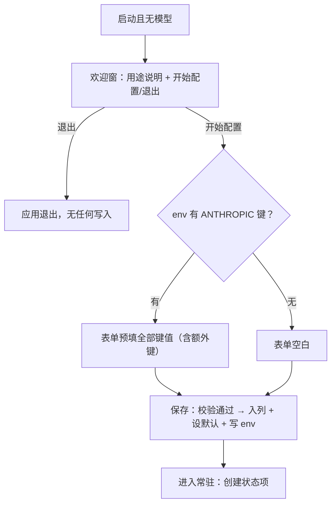
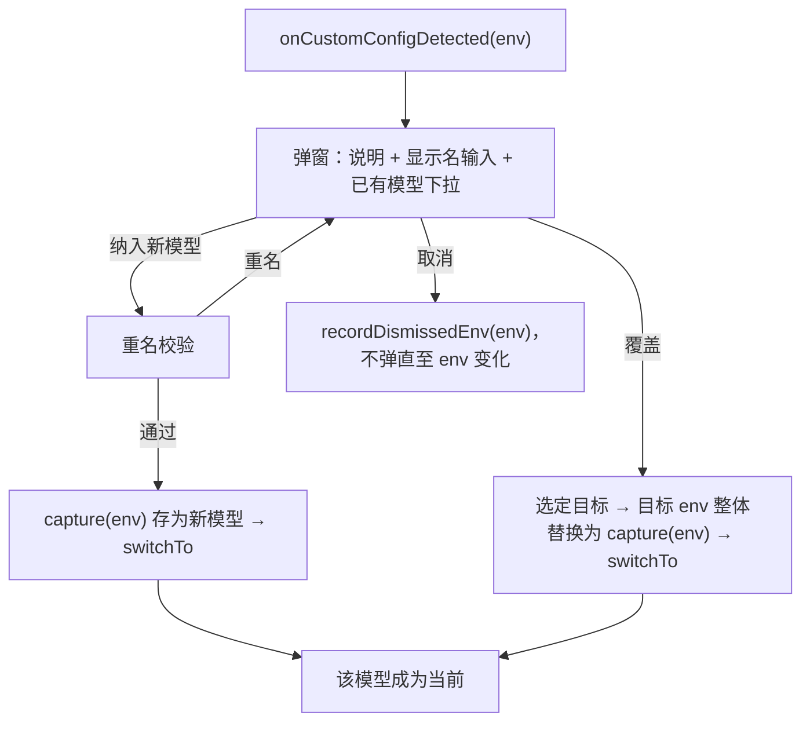

# CC Model 实施计划

> 读者假设：已读设计文档；懂软件工程，但不熟悉本项目的具体实现。
>
> 本文档回答：改哪些文件、每个功能单元怎么改、边界在哪、为什么这样改、有什么实施风险。

## 元数据

- **目标：** 需求方获得一个菜单栏应用：点菜单里的模型名即完成 Claude Code 供应商切换，配置被手动改动时能识别、纳入或覆盖，全部模型参数在偏好窗口管理。
- **架构：** 纯逻辑层（数据模型、键位规则、检测、菜单规格）与薄 UI 层（状态项菜单、SwiftUI 窗口、NSAlert 弹窗）分离；持久化两处——应用自有配置与应用外部的 Claude Code 全局配置。零第三方依赖。
- **技术栈：** Swift 5.9 / AppKit（NSStatusItem、NSMenu、NSAlert）/ SwiftUI（ObservableObject+@Published 路径）/ UserNotifications / ServiceManagement / SPM / XCTest。
- **设计文档（Spec）：** `docs/superpowers/specs/2026-11-04-cc-model/design.md`（2026-11-05 已确认）。
- **实施前决策记录 + 日期：** 2026-11-05。设计文档 §4 速览表九项决策 + 三项后续裁决（`_NAME` 同步、编辑生效中模型立即应用、额外键无管理界面）+ 覆盖出口补充，均已落定。
- 验证方案见同目录 `verification.md`。

## 1. 改动地图

全部新增，无既有代码。依赖方向：UI → 逻辑 → 数据/系统；数据层互不依赖。包名 `ccmodel`，产物为单一可执行文件，由打包脚本装入 .app。

**实施顺序：** 按任务编号顺序执行；Task 5–8 依次 Modify `Main.swift`，顺序不可调换。

| 文件 | 职责 |
|------|------|
| `Package.swift` | SPM 清单：可执行目标 + 测试目标，零依赖 |
| `Sources/ccmodel/Profile.swift` | ModelProfile 类型 |
| `Sources/ccmodel/ProfileFields.swift` | 字段↔env 键映射、`_NAME` 同步规则、校验、捕获 |
| `Sources/ccmodel/ModelStore.swift` | 应用配置持久化（模型列表、默认、开机自启、已忽略的自定义 env 状态） |
| `Sources/ccmodel/SettingsWriter.swift` | Claude Code 全局配置的 env 块替换引擎 |
| `Sources/ccmodel/CurrentModelDetector.swift` | env 与模型匹配判定 |
| `Sources/ccmodel/MenuBuilder.swift` | 菜单项规格与状态项标题的纯函数 |
| `Sources/ccmodel/ModelSwitcher.swift` | 切换编排（替换 env → 记录选中 → 通知） |
| `Sources/ccmodel/Notifier.swift` | 系统通知（含授权降级） |
| `Sources/ccmodel/Main.swift` + `AppDelegate.swift` | 进程装配、accessory 策略 |
| `Sources/ccmodel/StatusItemController.swift` | 状态项与菜单装配、点击路由 |
| `Sources/ccmodel/ProfileFormModel.swift` + `ProfileFormView.swift` | 表单（偏好与首跑共用） |
| `Sources/ccmodel/FirstRunCoordinator.swift` + `WelcomeWindow.swift` | 首跑欢迎窗与强制配置流 |
| `Sources/ccmodel/PreferencesWindow.swift` + `PreferencesViewModel.swift` | 偏好窗口（侧栏+详情） |
| `Sources/ccmodel/LoginItem.swift` | 开机自启登记 |
| `Sources/ccmodel/ImportDialog.swift` + `ImportCoordinator.swift` | 自定义配置三出口弹窗及其落库 |
| `scripts/make-app.sh` | 构建 + 组装 .app + ad-hoc 签名 |
| `Tests/ccmodelTests/*.swift` | 各任务单元测试 |

## 2. 功能单元规格

### Task 1: 数据模型与键位规则

**职责：** 交付 ModelProfile 类型与 ProfileFields 纯逻辑（映射/同步/校验/捕获），被全部后续任务依赖。

**Files:**
- Create: `Package.swift`、`Sources/ccmodel/Profile.swift`、`Sources/ccmodel/ProfileFields.swift`
- Test: `Tests/ccmodelTests/ProfileFieldsTests.swift`、`Tests/ccmodelTests/ValidationTests.swift`

**Interfaces:**
- Produces:
  - `struct ModelProfile: Codable, Identifiable, Equatable { var id: UUID; var displayName: String; var env: [String: String]; var lastSelectedAt: Date? }`
  - `enum ProfileField: String, CaseIterable { case baseURL, token, mainModel, fable, opus, sonnet, haiku }`，属性 `var envKey: String`——逐字对应 `ANTHROPIC_BASE_URL` / `ANTHROPIC_AUTH_TOKEN` / `ANTHROPIC_MODEL` / `ANTHROPIC_DEFAULT_FABLE_MODEL` / `ANTHROPIC_DEFAULT_OPUS_MODEL` / `ANTHROPIC_DEFAULT_SONNET_MODEL` / `ANTHROPIC_DEFAULT_HAIKU_MODEL`
  - `enum ProfileFields`：
    - `static let anthropicPrefix = "ANTHROPIC_"`
    - `static func tierDisplayKey(forTierKey: String) -> String?`（`..._SONNET_MODEL` → `..._SONNET_MODEL_NAME`；非档位解析键返回 nil）
    - `static func stripContextSuffix(_ value: String) -> String`
    - `static func fieldValues(fromEnv: [String: String]) -> [ProfileField: String]`
    - `static func capture(fromEnv: [String: String]) -> [String: String]`
    - `static func applyFieldEdit(field: ProfileField, newValue: String?, env: [String: String]) -> [String: String]`
    - `enum ValidationError: Equatable, Error { case emptyDisplayName, duplicateDisplayName, emptyRequired(ProfileField) }`
    - `static func validate(displayName: String, values: [ProfileField: String], existingNames: [String]) -> [ValidationError]`
    - `static func statusItemTitle(displayName: String) -> String`
  - `Package.swift`：swift-tools-version 5.9；platforms `macOS(.v13)`；executableTarget `ccmodel`（path `Sources/ccmodel`）+ testTarget `ccmodelTests`；dependencies 为空。
- 调用示例：`applyFieldEdit(field: .sonnet, newValue: "kimi-k3[1m]", env: ["ANTHROPIC_DEFAULT_SONNET_MODEL": "glm-5.3-flash[1M]", "ANTHROPIC_DEFAULT_SONNET_MODEL_NAME": "glm-5.3-flash"])` 返回 `["ANTHROPIC_DEFAULT_SONNET_MODEL": "kimi-k3[1m]", "ANTHROPIC_DEFAULT_SONNET_MODEL_NAME": "kimi-k3"]`。

**边界条件：**
- 执行语义
  - `applyFieldEdit` 写入的键名与设计文档 §2 F5 映射逐字一致。
  - `newValue` 去首尾空白后为空 → 视为清空：移除解析键；存在配对显示键时一并移除。
  - `newValue` 非空 → 解析键写入去空白后的原值（含用户输入的后缀，不做改写）。
- 同步规则（2026-11-04 裁决）
  - 档位编辑时，配对显示键当前值 == `stripContextSuffix(旧解析键值)` → 显示键更新为 `stripContextSuffix(新值)`；否则显示键不变。
  - `stripContextSuffix` 只去除结尾一个大小写不敏感的 `[1m]`/`[1M]`；`"glm-4.6[1m]x"` 原样返回；无后缀值原样返回。
- 捕获与校验
  - `capture` 只保留 `ANTHROPIC_` 前缀键；非前缀键一律不进模型。
  - displayName 去空白后为空 → `emptyDisplayName`；与 existingNames 任一去空白后相等 → `duplicateDisplayName`。
  - baseURL/token/mainModel 去空白后为空 → `emptyRequired(对应字段)`；四档为空不报错。
  - ❌「错误适当提示」 ✅「返回 `[ValidationError]`，空数组即通过」
- 状态项标题
  - `statusItemTitle` 返回 `"⇄ " + displayName`；displayName 超过 12 个字符 → 取前 12 字符追加「…」。

**验收标准：**
- 映射：`fieldValues(fromEnv:)` 对 7 键逐一取值正确；非规范 ANTHROPIC 键与非 ANTHROPIC 键均不出现在结果。
- 同步规则三例各一条断言：派生值跟随更新、自定义标签保留、清空双删；`[1M]` 与 `[1m]` 混合大小写各覆盖一例。
- 校验：三类错误各一条 + 全部通过返回空数组。
- 捕获：混合输入只留 ANTHROPIC 前缀键。
- 标题：短名原样加前缀；13 字符名截断。

### Task 2: 应用配置存储

**职责：** 交付 ModelStore——应用自有配置的持久化与 CRUD、排序、已忽略 env 状态管理；被切换链路与全部窗口依赖。

**Files:**
- Create: `Sources/ccmodel/ModelStore.swift`
- Test: `Tests/ccmodelTests/ModelStoreTests.swift`

**Interfaces:**
- Consumes: Task 1 的 `ModelProfile`。
- Produces:
  - `struct AppConfiguration: Codable, Equatable { var models: [ModelProfile]; var defaultModelID: UUID?; var launchAtLogin: Bool; var dismissedCustomEnvs: [[String: String]] }`（成员默认值：空列表、nil、false、空列表）
  - `enum ModelSort { static func ordered(_ models: [ModelProfile]) -> [ModelProfile] }`——排序唯一实现（Task 4 复用，防漂移）。
  - `final class ModelStore { init(directory: URL? = nil); private(set) var configuration: AppConfiguration; func load() throws; func save() throws; func add(_ model: ModelProfile); func update(_ model: ModelProfile) throws; func delete(id: UUID) throws; func setDefault(id: UUID) throws; func markSelected(id: UUID) throws; func recordDismissedEnv(_ env: [String: String]); func isDismissedEnv(_ env: [String: String]) -> Bool; var canDelete: Bool { get }; func menuOrderedModels() -> [ModelProfile] }`（`menuOrderedModels` 内部委托 `ModelSort.ordered`）
  - 默认目录 `~/Library/Application Support/cc-model`；文件 `config.json`；文件权限 0600，目录 0700。
- 调用示例：`store.delete(id: 默认模型id)` 后 `store.configuration.defaultModelID == store.configuration.models.first?.id`（删除默认自动补位，设计 §2 F4）。

**边界条件：**
- `delete` 后 models 为空 → 抛错（UI 置灰守卫之外的兜底）；删除非默认模型 → `defaultModelID` 不变。
- `setDefault` 传入不存在的 id → 抛错；`update`/`markSelected`/`delete` 同理。
- `save`：目录不存在则创建（0700）；写后文件权限 0600。
- `load`：文件缺失 → configuration 为默认空配置，不抛错；JSON 损坏 → 抛错且 configuration 保持载入前的值。
- `ModelSort.ordered`：有 lastSelectedAt 的按时间降序在前；nil 的保持添加顺序排在其后；nil 与 nil 之间保持 models 数组相对顺序。
- `isDismissedEnv`：入参经 `ProfileFields.capture` 过滤后与 dismissedCustomEnvs 任一元素完全相等 → true。
- `update` 以同 id 整体替换该模型（含 env 全键组）。

**验收标准：**
- 往返：add 两模型 + 设默认 + 记录忽略 env → save → 新实例 load → configuration 完全相等。
- 权限：save 后断言 0600。
- 删除：删默认补位、删非默认不动、仅剩一个时删除抛错，三条断言；setDefault/update/markSelected/delete 传入不存在 id 各抛错，四条断言；load 损坏 JSON 抛错一条断言。
- 排序（ModelSort.ordered）：有历史、混合 nil、纯 nil 三条断言。
- canDelete：count==1 → false；count==2 → true。
- isDismissedEnv：完全相等 true；任一键值不同 false。

### Task 3: settings.json 读写引擎

**职责：** 交付 SettingsWriter——对外部接口 `~/.claude/settings.json` 的 env 块替换引擎；被切换、覆盖、编辑应用、首跑依赖。

**Files:**
- Create: `Sources/ccmodel/SettingsWriter.swift`
- Test: `Tests/ccmodelTests/SettingsWriterTests.swift`

**Interfaces:**
- Consumes: 无（仅 Foundation）。
- Produces:
  - `struct SettingsWriter { init(directory: URL? = nil); var settingsURL: URL { get }; func readEnv() throws -> [String: String]; func replaceAnthropicEnv(with env: [String: String]) throws }`
  - 默认目录 `~/.claude`，文件 `settings.json`。
- 调用示例：env 现为 `{"DISABLE_AUTOUPDATER":"1","ANTHROPIC_BASE_URL":"a"}`，`replaceAnthropicEnv(with: ["ANTHROPIC_BASE_URL":"b","ANTHROPIC_MODEL":"m"])` 后 env 为 `{"DISABLE_AUTOUPDATER":"1","ANTHROPIC_BASE_URL":"b","ANTHROPIC_MODEL":"m"}`。

**边界条件：**
- 替换语义
  - 移除 env 块中全部 `ANTHROPIC_*` 键后写入新键组；非前缀键与全部其他顶层字段原值保留（键序与缩进不保证保留，内容级保留）。
  - env 块不存在 → 视为空并创建。
- 失败路径
  - 文件内容非合法 JSON → 抛错，文件字节不变。
  - 解析成功但写文件失败 → 抛错，原文件内容不变。写入采用临时文件 + 替换的原子替换语义，任何写失败不破坏原文件。
  - ❌「失败时尽量保持原状」 ✅「任何抛错路径下，settings.json 的字节内容与调用前完全一致」
- 创建路径
  - 文件不存在 → 以 `{"env": 新键组}` 创建；`.claude` 目录不存在 → 先创建。
- 读取
  - `readEnv` 文件缺失 → 返回 `[:]`；只返回 `ANTHROPIC_` 前缀键。

**验收标准：**
- 保留替换：非前缀键 + 其他顶层字段在替换后原值保留，ANTHROPIC 键组被精确替换。
- 创建：无文件 → 创建成功且内容正确。
- 损坏：非法 JSON → 抛错 + 原文件字节级不变（先读原数据，事后比对）。
- 写失败：以可行手段构造写入失败（如把替换目标预先占位为不可替换的目录）→ 抛错 + 原文件字节不变。
- 读取：缺文件返回空；混入非前缀键时只返回前缀键。

### Task 4: 当前模型识别与菜单规格

**职责：** 交付 CurrentModelDetector 与 MenuBuilder 纯函数——检测匹配与菜单项/标题规格；被状态项与导入弹窗依赖。

**Files:**
- Create: `Sources/ccmodel/CurrentModelDetector.swift`、`Sources/ccmodel/MenuBuilder.swift`
- Test: `Tests/ccmodelTests/DetectorTests.swift`、`Tests/ccmodelTests/MenuBuilderTests.swift`

**Interfaces:**
- Consumes: Task 1 `ModelProfile`、`ProfileFields.capture`、`statusItemTitle`；Task 2 `ModelSort.ordered`（排序唯一实现）。
- Produces:
  - `enum CurrentModelDetector { static func match(env: [String: String], in models: [ModelProfile]) -> ModelProfile.ID? }`
  - `struct MenuItemSpec: Equatable { enum Kind: Equatable { case model(UUID), customConfig, separator, preferences, quit }; var kind: Kind; var title: String; var isSelected: Bool; var isEnabled: Bool }`
  - `enum MenuBuilder { static func buildItems(models: [ModelProfile], currentID: ModelProfile.ID?, defaultID: UUID?, showsCustomConfig: Bool) -> [MenuItemSpec] }`
- 调用示例：models=[智谱, DeepSeek]、current=智谱、default=DeepSeek、showsCustomConfig=false → `[model(智谱, title="智谱", ✓), model(DeepSeek, title="DeepSeek（默认）"), separator, preferences("偏好设置…"), quit("退出 CC Model")]`。

**边界条件：**
- 匹配：env 先经 `capture` 过滤；键集合与某模型 env 完全相等且逐键值相等 → 返回该 id；否则 nil；空 env → nil。
- 菜单顺序：currentID 非空时该项排第 1 且 isSelected=true；其余按 `ModelSort.ordered`（lastSelectedAt 降序、nil 保持添加顺序）；showsCustomConfig=true 时 customConfig 项排最前，title 逐字「自定义配置」，isEnabled=false，且此时所有模型项 isSelected=false。
- 状态项图标形态（已裁决，2026-11-05）：以文本字符「⇄ 」前缀呈现。
- 标注与固定项：defaultID 对应项 title 追加逐字「（默认）」（含它是 current 时）；模型组与偏好设置之间恰一个 separator；preferences title 逐字「偏好设置…」isEnabled=true；quit title 逐字「退出 CC Model」。
- 退化输入：models 为空且 showsCustomConfig=true → `[customConfig, separator, preferences, quit]`；models 为空且 showsCustomConfig=false → `[separator, preferences, quit]`。

**验收标准：**
- 匹配四断言：全等命中、值不同不命中、键集合不同不命中、空 env 不命中。
- 菜单五状态各一条完整序列断言：常规（current 置顶勾选 + 默认标注）、custom 置顶置灰、current 不在 recency 首位时被强制提前、default==current 双标注、空列表退化（with/without customConfig 两态）。

### Task 5: 状态项菜单与切换链路

**职责：** 交付进程装配、状态项与菜单 UI、切换编排与通知——点菜单完成切换的主链路；被首跑/偏好/导入复用其编排件。

**Files:**
- Create: `Sources/ccmodel/Main.swift`、`Sources/ccmodel/AppDelegate.swift`、`Sources/ccmodel/StatusItemController.swift`、`Sources/ccmodel/ModelSwitcher.swift`、`Sources/ccmodel/Notifier.swift`
- Test: `Tests/ccmodelTests/ModelSwitcherTests.swift`

**流程图：**

**Interfaces:**
- Consumes: Task 1/2/3/4 全部产出。
- Produces:
  - `final class Notifier { func postSwitchSuccess(modelName: String); func postSwitchFailure(modelName: String) }`——文案逐字「已切换到〈name〉，对新建会话生效」/「切换到〈name〉失败，已保留原配置」；内部经注入闭包 `deliveryHandler: ((String) -> Void)?` 发送（nil 时走系统通知），作为测试缝。
  - `final class ModelSwitcher { init(store: ModelStore, writer: SettingsWriter, notifier: Notifier); func switchTo(id: UUID) throws; func applyEnv(_ env: [String: String]) throws; func currentModelID() -> UUID? }`
  - `StatusItemController`：`init(store: ModelStore, switcher: ModelSwitcher, onCustomConfigDetected: @escaping ([String: String]) -> Void)`；`func start()`。onCustomConfigDetected 在 Task 5 内为空实现占位，Task 8 注入真弹窗。
  - `Main.swift`：accessory 策略装配；configuration.models 为空 → 不创建状态项（首跑分支由 Task 6 接入）；非空 → `StatusItemController.start()`。
- 调用示例：`try switcher.switchTo(id)` 成功后：settings env 已替换、该模型 lastSelectedAt 已更新并落盘、notifier 收到成功文案。

**边界条件：**
- 切换顺序：`switchTo` 先 `writer.replaceAnthropicEnv(profile.env)`，成功后 `store.markSelected(id)` 并 save。
- 失败：writer 抛错 → 不 markSelected、不 save，`postSwitchFailure`；传入不存在 id → 抛错且不触达 writer。
- `applyEnv`：仅替换 env + 成功通知，不改 lastSelectedAt（供编辑生效中模型使用）。
- `currentModelID`：`readEnv` + `match`；readEnv 抛错 → 返回 nil。
- 状态项：title 用 `statusItemTitle(当前模型显示名)`；切换成功后立即刷新；应用无 Dock 图标。
- 菜单：`menuNeedsUpdate` 内重新读 env 并以 `MenuBuilder.buildItems` 重建全部条目；点击 model 项 → `switchTo`；preferences/quit 分别打开偏好窗口占位（Task 7 前为空操作）与 `NSApp.terminate`。
- 自定义配置触发：menuDidClose 时若「未命中且 !store.isDismissedEnv(env)」→ 以当前 env 调 onCustomConfigDetected 恰一次； dismissed 后同 env 不再触发。dismissed 判定采用**内容等价口径**（已裁决，2026-11-05：同 env 不再询问，覆盖「拒绝 A → 换 B → 回到 A」场景）。
- readEnv 失败：menuNeedsUpdate 中 readEnv 抛错（settings.json 损坏）→ 菜单照常构建，customConfig 置灰项显示，但 onCustomConfigDetected **不回调**（无法获得 env）；状态项标题显示「⇄ —」。
- 应用配置损坏的进程行为（已裁决，2026-11-05）：`store.load()` 抛错时弹说明窗——含配置文件路径与解决建议（修复该文件的 JSON 语法，或删除该文件后重启应用、重新走首次配置）——用户确认后退出应用；**绝不静默按空配置进入首跑**。
- 通知：首次 post 前请求授权恰一次；被拒 → 后续不再请求、不发通知、不报错。授权请求路径不可注入，无单测断言，由 verification.md S11 人工核对。

**验收标准（单测覆盖可测件；NSStatusItem/NSMenu 装配由 verification.md S1/S3 人工核对）：**
- 成功切换：临时目录 store+writer 下 env 替换正确、lastSelectedAt 更新、spy notifier（经 deliveryHandler）收到成功文案。
- 失败：writer 指向损坏文件 → spy 收到失败文案、store 未变、settings 文件字节不变。
- `currentModelID` 命中/未命中两断言；`applyEnv` 替换 env 且不改 lastSelectedAt 一条断言。
- 通知文案逐字断言（spy 捕获）。

### Task 6: 模型表单与首跑流程

**职责：** 交付偏好与首跑共用的表单件与首跑强制配置流；表单被 Task 7 复用。

**Files:**
- Create: `Sources/ccmodel/ProfileFormModel.swift`、`Sources/ccmodel/ProfileFormView.swift`、`Sources/ccmodel/FirstRunCoordinator.swift`、`Sources/ccmodel/WelcomeWindow.swift`
- Modify: `Sources/ccmodel/Main.swift`（configuration.models 为空的分支接入 FirstRunCoordinator——空 → 首跑流；首跑完成后回调创建状态项）
- Test: `Tests/ccmodelTests/ProfileFormModelTests.swift`

**流程图：**

**Interfaces:**
- Consumes: Task 1 `ProfileFields`、Task 2 `ModelStore`、Task 3 `SettingsWriter`、Task 5 `ModelSwitcher`。
- Produces:
  - `final class ProfileFormModel: ObservableObject`——`@Published var displayName/baseURL/token/mainModel/fable/opus/sonnet/haiku: String`、`@Published var isDefault: Bool`、`let extras: [String: String]`；`init()`（全空、extras 空）、`init(profile: ModelProfile, isDefault: Bool)`；`func fieldValues() -> [ProfileField: String]`；`func validate(existingNames: [String]) -> [ProfileFields.ValidationError]`；`func makeProfile(original: ModelProfile?) -> ModelProfile`。
  - **extras 定义：** `capture(env)` 剔除 7 个规范键与 4 个档位 `_NAME` 显示键后的剩余集合——表单 8 字段与档位显示键由 `applyFieldEdit`（含同步规则）管辖，extras 与其零交集，合并时不存在覆盖冲突。
  - `ProfileFormView`：SwiftUI Form，8 输入行（token 行为 SecureField + 行内明/密文切换控件，默认密码态）+「设为默认」Toggle；由外部视图持有 model。
  - `ProfileFormModel` 便利构造：`static func fromCapturedEnv(_ env: [String: String]) -> ProfileFormModel`——8 字段取 `fieldValues(fromEnv:)`，extras 取 `capture(fromEnv:)`，displayName 空、isDefault false（首跑预填落点，可单测）。
  - `final class FirstRunCoordinator { init(store: ModelStore, switcher: ModelSwitcher, onFinished: @escaping () -> Void); func runIfNeeded() }`——无模型时展示欢迎窗；「开始配置」→ 表单窗（`fromCapturedEnv(writer.readEnv())` 预填）；「退出」→ `NSApp.terminate`。
- 调用示例：`makeProfile(original: nil)` 于全空表单返回 env 恰含 3 个必填规范键的 ModelProfile。

**边界条件：**
- 表单落库：`makeProfile(original:)` 以 original?.env 为基底逐字段 `applyFieldEdit`（同步规则随之生效），末尾并入 extras（extras 与规范键/档位显示键零交集，不覆盖任何已处理键）；original 为 nil → 新 UUID、lastSelectedAt nil。
- 预填：`fromCapturedEnv` 于 env 空 → 表单全空、extras 空；env 有值 → 8 字段取值 + extras 按上述定义剔除后保留，displayName 留空。
- 强制性：欢迎窗与表单窗均无标准关闭按钮出口；仅「开始配置/退出」与「保存」路径。
- 保存：validate 通过 → `store.add` + `setDefault` + `switcher.applyEnv`（对已捕获 env 是幂等写；此步为计划对设计 F6 的澄清性扩充——写入与捕获同键组，语义等价）→ 关窗 + onFinished；不通过 → 逐字段提示且不落库。
- 校验名单语义：`validate(existingNames:)` 的名单为「除当前编辑对象外」的全部显示名；编辑不改名保存不触发重名错误。
- 首跑保存写 env 在设计 F6 流程图无节点，属上述澄清性扩充，非行为新增。

**验收标准：**
- `makeProfile` 四断言：新建含 3 必填键；从已有模型载入再保存后 extras 保留且不被写回覆盖；清空档位后该解析键与显示键均不存在（extras 不加回）；档位编辑触发同步规则。
- 预填两断言（`fromCapturedEnv`）：空 env 全空；有值 env 字段与 extras 齐全（extras 已剔除规范键与档位显示键）且 displayName 为空。
- validate 委托 Task 1 规则的对接断言（空名、重名、缺必填）。
- 强制出口与保存流由 verification.md S6 人工核对。

### Task 7: 偏好窗口与开机自启

**职责：** 交付侧栏+详情偏好窗口、增删改语义与登录项开关；编辑生效中模型的立即应用在此落地。

**Files:**
- Create: `Sources/ccmodel/PreferencesViewModel.swift`、`Sources/ccmodel/PreferencesWindow.swift`、`Sources/ccmodel/LoginItem.swift`
- Modify: `Sources/ccmodel/Main.swift`（装配 PreferencesWindow，并把 StatusItemController 的 preferences 动作从空操作改为打开该窗口）
- Test: `Tests/ccmodelTests/PreferencesViewModelTests.swift`

**Interfaces:**
- Consumes: Task 1/2/3/5/6 产出。
- Produces:
  - `final class PreferencesViewModel: ObservableObject { init(store: ModelStore, switcher: ModelSwitcher); @Published var modelList: [ModelProfile]; @Published var selectedID: UUID?; @Published var form: ProfileFormModel; @Published var launchAtLogin: Bool; var canDelete: Bool { get }; func reload(); func select(id: UUID); func beginAdd(); func deleteSelected() throws; func saveForm() throws; func setLaunchAtLogin(_ on: Bool) }`
  - `PreferencesWindow`：NavigationSplitView——侧栏 List（行内含默认徽标「默认」逐字）+ 侧栏底部 ＋/－ 与「开机自启」开关；详情为 `ProfileFormView` +「保存」按钮。
  - `enum LoginItem { static func setEnabled(_ on: Bool) throws; static var isEnabled: Bool { get } }`
- 调用示例：仅剩一个模型时 `vm.canDelete == false`，对应 － 按钮置灰（设计 §2 F4）。

**边界条件：**
- 列表：按添加顺序稳定展示，不受菜单重排影响；默认行显示徽标。
- `beginAdd`：表单清空进入新建态，保存成功才追加到列表尾并选中；不自动成为当前，不自动默认（除非勾选）。
- `deleteSelected`：canDelete 为 false 时调用 → 抛错；删除默认模型 → 首个补为默认（Task 2 语义）；删除当前生效模型 → 只删记录不写 env（env 漂移交由 F3 流程）。
- `saveForm`：校验名单传「除被编辑模型自身外」的全部显示名；校验失败 → 抛出错误数组、store 不变；通过 → 新模型 `add`（isDefault=true 则 `setDefault`）/ 已有模型 `update`；被编辑模型为当前生效模型 → 追加 `switcher.applyEnv(form 落库 env)` + 成功通知；不是当前 → 不写 env。
- 默认唯一：保存时 form.isDefault=true → `setDefault(id)`；false 且该模型原是默认 → `defaultModelID` 改为 models 首个。
- `setLaunchAtLogin(true)`：`LoginItem.setEnabled` + `store.launchAtLogin` 持久化；SMAppService 抛错 → 界面提示且开关回拨为 false、store 不变；false 同理 unregister。
- 开关初始值取 `store.launchAtLogin`（持久事实为准），不读 `LoginItem.isEnabled`。

**验收标准：**
- canDelete 边界两断言；删除默认补位一断言；删除当前生效模型不触达 writer（spy 断言）。
- saveForm：校验失败不落库一断言；编辑生效中模型触发 applyEnv 一断言（以临时目录 writer 的文件状态断言 env 替换发生）；编辑非当前模型不触达 writer 一断言。
- 默认唯一：保存勾选默认覆盖旧默认一断言；取消勾选回落首个一断言。
- setLaunchAtLogin 失败回拨一断言（注入抛错的 LoginItem 替身——LoginItem 以可注入闭包 `setEnabledHandler` 暴露测试缝）。
- 窗口布局与徽标由 verification.md 人工核对。

### Task 8: 自定义配置导入弹窗

**职责：** 交付三出口导入弹窗与落库编排——纳入新模型、覆盖已有模型、取消。

**Files:**
- Create: `Sources/ccmodel/ImportCoordinator.swift`、`Sources/ccmodel/ImportDialog.swift`
- Modify: `Sources/ccmodel/Main.swift`（StatusItemController 的 onCustomConfigDetected 从空占位注入 ImportDialog 呈现）
- Test: `Tests/ccmodelTests/ImportCoordinatorTests.swift`

**流程图：**

**Interfaces:**
- Consumes: Task 1/2/3/5 产出。
- Produces:
  - `enum ImportDecision: Equatable { case newModel(name: String), overwrite(targetID: UUID), cancel }`
  - `enum ImportCoordinator { static func decide(_ decision: ImportDecision, env: [String: String], store: ModelStore, switcher: ModelSwitcher) throws }`
  - `ImportDialog`：NSAlert 呈现——说明文字 + 显示名 NSTextField + 已有模型 NSPopUpButton；回调 `ImportDecision`。由 StatusItemController 的 onCustomConfigDetected 在 menuDidClose 后调用。
- 调用示例：`decide(.overwrite(targetID: d), env: e, ...)` 后 d 模型的 env 与 `ProfileFields.capture(e)` 完全相等，displayName 与 defaultModelID 不变，lastSelectedAt 更新，d 成为当前模型。

**边界条件：**
- 空值兜底：`capture(env)` 结果为空（settings.json 读取失败的空 env）→ newModel/overwrite 均抛错，不入库、不写 settings。
- 新模型：name 先重名校验（重名 → 抛 `duplicateDisplayName`，弹窗层拦截后不会发生，此处兜底）；通过 → `capture(env)` 存为新模型 → `switchTo`（成为当前 + 通知）。
- 覆盖：目标 env 被 `capture(env)` 整体替换（键集合也换）；displayName 与 defaultModelID 保持；lastSelectedAt 经 `switchTo` 更新为当前时间；经 `switchTo` 成为当前。
- 取消：`recordDismissedEnv(env)`；此后同 env 打开菜单不再触发弹窗；env 任一 ANTHROPIC 键值变化 → 视为新状态再次触发。
- 弹窗行为：重名输入时弹窗保持呈现并提示改名，直至输入有效或用户取消（NSAlert 无原生校验循环，实现机制由实施者决定，行为以本条为准）。
- 弹窗呈现时机：仅在 menuDidClose 后（Task 5 契约保证）；弹窗自身可重复触发前需先关闭。

**验收标准：**
- 空值兜底：空 env 时 newModel 与 overwrite 均抛错且 store 不变，两断言（cancel 走既有取消语义，不在此路径）。
- 新模型：重名抛错一断言；成功后列表 +1、成为当前、spy 收到通知一断言。
- 覆盖：整体替换 + 显示名/默认保持 + lastSelectedAt 更新 + 成为当前，一断言。
- 取消：dismissed 记录生效、同 env 查 true、改一键值后查 false，三断言。

### Task 9: .app 打包与交付

**职责：** 交付构建脚本与 .app 产物——可放入 /Applications 运行的最终交付形态。

**Files:**
- Create: `scripts/make-app.sh`、脚本内生成的 `dist/CC Model.app/Contents/Info.plist`

**Interfaces:**
- Produces: `bash scripts/make-app.sh` → `dist/CC Model.app`，退出码 0；`codesign -dv dist/"CC Model.app"` 可读出 ad-hoc 签名。
- Info.plist 逐字槽位：`CFBundleName=CC Model`、`CFBundleDisplayName=CC Model`、`CFBundleIdentifier=com.ccmodel.app`、`CFBundleExecutable=ccmodel`、`CFBundlePackageType=APPL`、`CFBundleShortVersionString=0.1.0`、`LSUIElement=true`、`LSMinimumSystemVersion=13.0`、`NSHighResolutionCapable=true`。

**边界条件：**
- 脚本可重复运行：每次先删除旧 dist 再重建。
- swift build 或 codesign 任一步失败 → 脚本以非零退出码结束。
- 产物结构：`Contents/MacOS/ccmodel`（release 可执行）+ `Contents/Info.plist`。
- 脚本成功结束前打印提示：将 CC Model.app 放入 /Applications 以便登录项登记。

**验收标准：**
- 脚本运行 exit 0，产物存在，`plutil -lint` 通过，`codesign -dv` 通过。
- 连续第二次运行仍 exit 0；构造构建失败（如临时移走 Sources 目录）→ 非零退出。
- 双击/`open` 启动后菜单栏出现状态项（verification.md S13 人工核对）。

## 3. 设计依据

1. **SettingsWriter 用 JSONSerialization 全量读写，而非文本锚点替换。** 候选：文本级定向替换（保留原格式）；JSON 解析后整体重写。选择后者：外部文件由 Claude Code 拥有，顶层字段集不受本应用控制，文本替换对未知结构脆弱；JSON 重写保证任意顶层内容语义级保留（设计 §2 F2）。代价：键序与缩进不保留——内容级保留已满足设计，观感差异在验证场景 S1 核对。
2. **纯逻辑与薄 UI 分层。** 菜单规格、键位规则、检测、导入落库全部纯函数化，XCTest 可覆盖全部行为分支；NSStatusItem/NSMenu/SwiftUI 视图薄到只做装配，人工清单核对。依据：自审可测性检查——UI 直接测试需重型 mock，纯函数零 mock 即可调用。
3. **菜单每次打开全量重建（menuNeedsUpdate）。** 候选：缓存 + env 变更事件失效；每次重建。选择重建：设计 §2 F1 要求每次打开菜单重新识别，本地文件读取耗时极低，重建成本可忽略，且天然消除缓存失效 bug 面。
4. **弹窗用 NSAlert 而非 SwiftUI 窗口。** 菜单关闭后弹原生模态最稳（NSMenu 追踪与 SwiftUI 窗口时序坑多），实现量最小。代价：样式朴素，功能与三出口语义不受影响。

## 4. 约束

- **状态管理红线：** SwiftUI 只用已实测路径——`ObservableObject`+`@Published`+`@ObservedObject` 或 `@Observable`；禁用 `@State` 及其他依赖 SwiftUIMacros 插件的包装器（CLT 环境无该插件，2026-11-04 实测）。
- **零依赖：** 不引入任何第三方包；仅系统框架 Foundation/AppKit/SwiftUI/UserNotifications/ServiceManagement；测试框架用 swift-testing（CLT 环境实测不含 XCTest API，2026-11-05 实施裁定——swift-testing 随工具链分发，非第三方依赖）。
- **真实配置保护：** 单元测试一律注入临时目录，禁止读写真实 `~/.claude/settings.json` 与真实应用配置目录；集成验证操作真实文件前必须备份、结束必须恢复（见 verification.md）。
- **失败不变性：** settings.json 任何写失败路径下原文件字节不变。
- **平台：** macOS 13+ API 下限，arm64；主线程单队列，不加锁。
- **分支：** 全部工作在 `feature/cc-model-app` 分支；main 只承载集成动作。
- **文案逐字：** 通知与菜单文案以本计划 Interfaces 处的逐字串为准；「（默认）」「自定义配置」「偏好设置…」「退出 CC Model」「默认」徽标、readEnv 失败时的状态项标题「⇄ —」同此。

## 5. 风险清单

| 风险 | 触发条件 | 影响 | 缓解方式 |
|------|---------|------|---------|
| settings.json 被重写后键序/缩进变化 | 每次切换写入 | Claude Code 解析不受影响（JSON 语义等价），用户 diff 观感变化 | S1 场景核对内容等价；设计 §2 F2 已声明内容级保留 |
| NSMenu 追踪期间弹模态窗导致挂起 | 弹窗在菜单未关闭时呈现 | 应用卡死 | 弹窗只在 menuDidClose 后呈现（Task 5 契约）；S3 验证 |
| 误用 @State 等宏包装器 | SwiftUI 编码时引入 @State 等依赖 SwiftUIMacros 的包装器 | 编译失败（即时暴露，非隐蔽） | 约束红线；每次任务以编译通过收尾 |
| SMAppService 在非 /Applications 位置注册失败 | 开发目录直接运行时开登录项 | 开关报错回拨 | Task 7 失败提示；交付脚本输出提示放置 /Applications |
| 测试误触真实配置 | 测试未注入目录 | 用户真实配置被污染 | 约束红线；审读与验证双重把关 |
| 并发写竞态覆盖对方更新 | Claude Code 与本应用同时写入 | 丢失一次更新 | 设计 §5 已接受（双方人工级低频） |
| 通知授权被拒 | 首次请求被拒 | 切换无回执 | 静默降级为设计既定行为；S11 人工核对 |

## 执行交接

- **建议执行方式：子代理驱动。** 理由：9 个任务接口依赖呈链式但各自验收标准可独立判真伪，单任务不良产物（尤其 Task 3 类外部接口错误）代价高，逐任务「实施 + 全新审查者把关」最稳。
- 必需子技能：子代理驱动用 `superpowers:subagent-driven-development`；会话内执行用 `superpowers:executing-plans`。
- 请需求方审查：各任务的边界条件与验收标准是否忠实覆盖设计文档的功能清单与「明确不做」清单。
- 明确确认后才进入实施；「嗯」「继续」不算明确确认。执行在现有 `feature/cc-model-app` 分支上进行，不另建工作树。
- 实施开始后发现设计必须改：停止实施，回到设计确认门；返工还是回滚由需求方决定。

## 附录：独立审读处置记录

**审读者身份：** 全新 general-purpose 子代理，未参与写作；首轮三张清单（完备性 / 可读性 / 实现效果）审读后，修订段落交回同一子代理两轮快速复读。

**首轮审读处置：**

- 映射表：F1–F7 均有任务承接（F3、F5 部分覆盖，经修订补齐）；「明确不做」七条无任务越界。
- 归需求方 4 项 → 已于 2026-11-05 全部裁决并回写正文：①配置损坏弹说明窗（含解决建议：修复 JSON 或删除文件重走首跑）后退出，不静默进首跑；②S6 采用环境变量 `CC_MODEL_CONFIG_DIR` 指向临时配置目录；③状态项图标以文本「⇄ 」前缀；④dismissed 采用内容等价口径。
- 次要 11 项 → 全部修订：`ModelSort.ordered` 唯一排序实现；T3 原子替换 + 写失败验收；validate 名单排自身；T8 弹窗循环行为与 lastSelectedAt 修正；readEnv 失败链兜底；token 明/密切换承接；T9 提示输出与验收补齐；实施顺序声明；launchAtLogin 初始值取 store；风险表措辞修正。
- 已有答案 12 项 → extras 零交集重定义（高危项）；S7/S8 补备份恢复；新增 S15 新会话场景；出处与体例修正；S12 条件式措辞。未采纳 2 项：设计 §5 成本上限不作为可验收判据（估计值属计划元数据）；设计「留给构建者的部分」H4 标题为模板规定结构，不调整。
- 可读性 6 项 → 随上述修订消解；排版逐行清点（表格列数、围栏配对、mermaid、标题、嵌套）通过。
- 实现效果：F1/F2/F4/F7 判「能达成」（有验收原句）；F3/F5/F6 判「有疑问」→ 经本轮修订闭合；未发现设计不可行，不回设计确认门。

**复读第一轮新发现 9 项处置：**

- 中 2 项：S15 与 S1 清理冲突 → S15 改为「S1 期望核对后、清理前连续执行」；S7/S8 恢复备份补「先退出应用」。
- 低 7 项：T8 空值兜底验收口径统一为 newModel/overwrite 两断言（cancel 走取消语义）；S10 出处改回 §4；S15 移至 S14 之后；处置记录落盘（本附录）；T4 图标句删「与已确认视觉稿一致」的无出处断言；「⇄ —」登记进 §4 文案逐字清单；I-5 说明补「校验规则与首跑表单共用」。
- 复读核对：13 项处置中 12 项落实判定通过；机械清点（三文档表格列数、围栏配对、mermaid）通过。

**复读第二轮核对结论：** 上述 9 项处置已全部落实，无新问题残留（本附录即第 6 项「处置落盘」的落实）。

**实施裁定（2026-11-05）：** Task 1 实施中实测 CLT（Swift 6.4.2）不随附 XCTest 测试 API（仅 swift-testing）。裁定测试框架改用 swift-testing（import Testing / @Test / #expect）——随工具链分发，非第三方依赖，「零依赖」约束意图不变；Tasks 2–9 测试同口径。该环境事实修正不改行为与范围。
